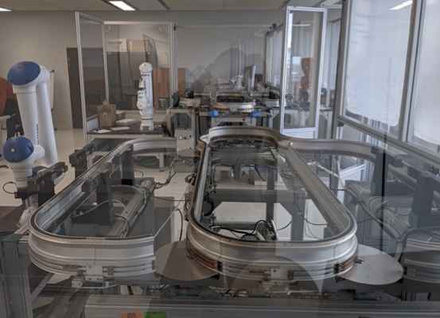
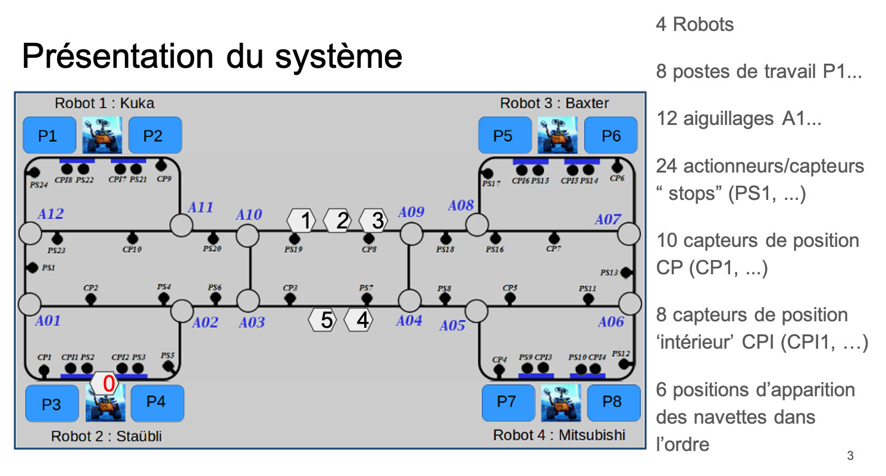

# Shuttles and robots challenge for students 
Projet atelier flexible robotisé MFJA

## 1) Partie informative à destination des étudiants

### 1.1) Vidéo de présentation
La vidéo suivante montre un exemple de ce que peut faire la simulation sur CoppeliaSim :

https://user-images.githubusercontent.com/84821679/198697250-7861b35a-a503-4246-86e2-939076bb784c.mp4



### 1.2) Présentation générale du projet
L’objectif de ce projet est d’amener les étudiants à concevoir puis à implémenter un réseau de Pétri afin d’en comprendre concrètement l’utilité et les applications.

Comme support pédagogique, nous utilisons la cellule flexible existante de la MFJA, composée de bras robots et de navettes, ainsi que sa représentation virtuelle combinant ROS2 et CoppeliaSim.

Le réseau de Pétri ainsi implémenté permettra de piloter les navettes, les aiguillages et les bras robotiques de la simulation dans un premier temps, puis de la maquette une fois la simulation validée, afin d'être capable de réaliser n'importe quelle séquence de production donnée, à l’image du fonctionnement d’une véritable usine.

Ce TER "atelier flexible robotisé" a donc pour ambition de développer et de mettre en œuvre la capacité à produire automatiquement et en parallèle au sein d’un atelier flexible.


### 1.3) Fonctionnement de la simulation
La simulation prend en entrée une séquence de production, décrivant les produits à faire, ainsi que les tâches qui les composent.

A partir de cette séquence, nous allons avoir 8 postes de production qui vont réaliser les tâches à faire. Les produits seront représentés par un empilement de cubes de couleur : un cube pour le type de produit et un cube pour chaque tâche effectuée. Les cubes seront transparents quand la tâche sera en cours et opaque quand elle sera terminée.

A la fin d'une tâche, si la tâche suivante ne se fait pas sur le même poste, il faut déplacer le produit. Nous appelons alors le robot du poste sur lequel on est, soit pour déplacer le produit au poste conjugué (2 postes par robot), soit pour le déplacer à une navette. Les navettes servent à transporter un produit jusqu'à une autre paire de poste.

La navette va naviguer sur un circuit, comportant des capteurs de position, des actionneurs et des aiguillages. Cela permet de diriger les navettes et de les arrêter à un endroit voulu.

L'évacuation du produit se fait lorsque toutes ses tâches sont terminées.

Nous rappelons les règles à respecter : 
* Le type du produit doit être compris entre 1 et 6
* Le nombre de tâches à faire par produit doit être compris entre 1 et 5
* Un poste ne peut faire qu'une seule tâche d'un seul produit en même temps
* L'évacuation du produit doit s'effectuer exclusivement par l'un des postes de sortie désignés
* Interdiction de circuler ou de stationner sur les voies près des postes si ce n'est pour y amener/récupérer un produit

Le schéma suivant permet de repérer les aiguillages, les capteurs, les postes et les robots:



### 1.4) Lancement de la simulation
Nous avons plusieurs moyens de lancer la simulation. Cependant, le moyen le plus simple et celui utilisé par les étudiants consiste à exécuter les lignes suivantes (après avoir ouvert un terminal depuis ce dossier) :
* Pour aller dans le dossier etu :
  ```bash
     cd etu
   ```
* Pour récupérer l'exemple Tuto_Basique :
  ```bash
     cp exemple/Tuto_Basique.main_commande.cpp .
   ```
* Pour compiler les modifications :
  ```bash
     source script0_Compile.sh Tuto_Basique dataP2_1_1_n0
   ```
* Pour lancer l'exécution de la simulation :
  ```bash
     ./script1_Run.sh
   ```
* Pour récupérer les logs après la fin de la simulation et valider son bon déroulement
  ```bash
     ./script2_GetSimuOutput.sh Tuto_Basique dataP2_1_1_n0
     ./script3_Validation.sh Tuto_Basique dataP2_1_1_n0
   ```
* Pour générer la documentation associée au fichier de commande.
  ```bash
     ./script4_Documentation.sh Tuto_Basique
   ```
   
   
## 2) Partie développement

### 2.1) Installation
Le protocole pour l'installation est à retrouver dans le fichier "tutoriel_installation".

### 2.2) Contenu de chaque dossier
Nous utilisons pour le moment la version **V4.3.0 Edu** de CoppeliaSim et la version **Jazzy** de ROS2.

Dans le dossier celluleflexible, nous retrouvons toute la partie bas niveau de la simulation, ainsi que la communication entre CoppeliaSim et ROS2.

Dans le dossier etu, nous retrouvons tout le matériel mis à disposition pour les étudiants, à savoir les scripts de lancement, des exemples de séquence de production et des exemples de réseau de Pétri.

Le logiciel CoppeliaSim est récupéré directement lors du téléchargement du dossier GitHub, mais il faut installer ROS2, ainsi que quelques extensions (voir "tutoriel_installation").

